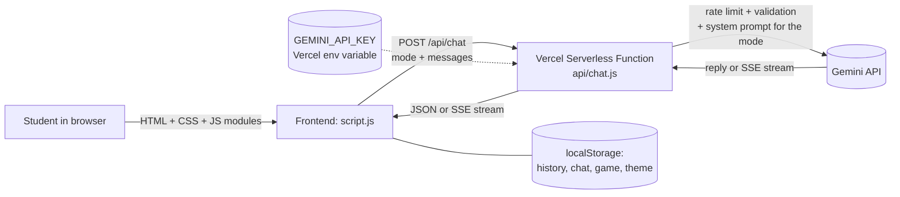

# 🔥 PromptForge

**Forge better prompts.** A website where students learn prompt engineering by scoring, fixing and practicing their prompts, with a working AI chatbot (**Prompt Coach**).

> **Live website:** `(https://promptforge-mocha-one.vercel.app)`
> **Team:** `VANSHAJ, KANISHK, MITANSH, SUMIT`

## Problem
Students write weak prompts but get no feedback on why they are weak, so they repeat the same mistakes and get poor AI outputs.

## Target audience
Engineering and school students learning prompt engineering, including Hindi/Hinglish speakers.

## Objectives
- Teach the **five parts of a good prompt**: Role, Task, Context, Constraints, Output Format.
- Give instant, measurable feedback on any prompt.
- Let students practice through a game and ask doubts to an AI coach.

## Features

| # | Feature | What it does |
|---|---|---|
| 1 | **Prompt X-Ray** | Scores a prompt on the 5 parts with a radar chart, highlights missing parts, gives a template rewrite |
| 2 | **🤖 AI Judge** | Gemini scores the prompt (0-10 per part) with a tip for each part. Compare with the instant rule-based score |
| 3 | **Before/After Diff** | "Improve with AI" streams a rewrite, then shows word-level green/red changes |
| 4 | **Prompt Battle** | 5 levels. Checklist mode (rules) or **AI mode**: your prompt is really run by Gemini and an AI judge compares the output with the target |
| 5 | **Hinglish Mode** | Converts a Hinglish request into a structured English prompt |
| 6 | **Live Technique Lab** | One task is run with Zero-shot, Few-shot, Chain-of-Thought and Role prompting, so real outputs can be compared |
| 7 | **Progress graph** | Every X-Ray score is saved in the browser and plotted as a line chart |
| 8 | **Prompt Coach chatbot** | Gemini chatbot with **streaming replies**, saved chat history, clear button, voice input, error handling |
| 9 | **Voice input** | Speak your prompt or chat question (Web Speech API, Chrome/Edge) |
| 10 | **Share card + Export** | Download your score as a PNG card, a `.txt` report or PDF (print dialog) |
| 11 | **Dark / Light theme** | Remembers your choice |
| 12 | **English / Hinglish interface** | Toggle button in the navbar |
| 13 | **Polish** | Favicon, meta tags, 404 page, loading skeletons, toast messages, reduced-motion support |
| 14 | **Rate limiting** | 20 requests / minute / IP in the API to prevent key misuse |
| 15 | **Automated tests + CI** | 30 unit tests (`npm test`) and a GitHub Actions workflow |

## Architecture



The browser never sees the API key. Each feature uses one **mode** with its own system prompt (see [PROMPTS.md](PROMPTS.md)): `coach`, `hinglish`, `rewrite`, `judge`, `run`, `battlejudge`.

## Folder structure
```
promptforge/
├── index.html        # page structure
├── style.css         # dark/light theme, layout, chatbot
├── script.js         # UI logic (ES module)
├── lib/
│   ├── scoring.js    # 5-part scoring, battle levels, helpers (unit tested)
│   ├── diff.js       # word-level diff (unit tested)
│   └── rateLimit.js  # sliding-window rate limiter (unit tested)
├── api/chat.js       # serverless function: validation, system prompts, Gemini call, streaming
├── tests/            # node:test unit + API tests
├── .github/workflows/test.yml
├── favicon.svg, 404.html
├── .env.example, .gitignore, package.json
└── README.md, PROMPTS.md
```

## Technologies
HTML, CSS, vanilla JavaScript (ES modules), Chart.js, Vercel Serverless Functions (Node.js), Groq API (primary) + Google Gemini API (automatic backup), Server-Sent Events, Web Speech API, Canvas API, GitHub Actions, Node test runner.

## AI tools used
| Tool | Contribution |
|---|---|
| Claude | Generated the initial website and backend from the five-part prompt; added the Prompt Coach chatbot, Groq/Gemini fallback, tests and deployment fixes |
| Perplexity | Literature research on few-shot, chain-of-thought and LLM-as-a-judge; supported the problem statement |
| Lovable | Prototyped the UI layout (hero, score radar section, chat widget) used as design reference |
| Cursor | Code review of api/chat.js and script.js, security checks and chatbot test cases |
## How the chatbot works
1. User types (or speaks) in the chat widget. `script.js` blocks empty and >1000 character messages.
2. The browser sends `POST /api/chat` with `{ mode: "coach", messages, stream: true }`.
3. `api/chat.js` checks the rate limit, validates input, adds the Prompt Coach system prompt and calls the Groq API using `GROQ_API_KEY` from environment variables. If Groq is busy or fails, it automatically retries on Gemini (`GEMINI_API_KEY`).
4. The provider's stream is converted into small events (`data: {"t":"..."}`) and the browser appends text as it arrives (typing effect).
5. On any error (offline, 429, API error, empty reply) a friendly message is shown and the failed message is removed from history.

## Run locally
```bash
npm i -g vercel
cp .env.example .env      # then paste your keys from https://console.groq.com and https://aistudio.google.com/apikey
vercel dev                # open the URL it prints
```
Run tests: `npm test` (needs Node 18+).

## Deploy on Vercel
1. Push this repo to GitHub.
2. Vercel → New Project → import the repo.
3. Settings → Environment Variables → add `GROQ_API_KEY` (primary) and `GEMINI_API_KEY` (backup). Optional: `GROQ_MODEL`, `GEMINI_MODEL`. Redeploy after changing variables.
4. Deploy, then paste the live URL at the top of this README.

## Notes
- Voice input works in Chrome/Edge. In Hinglish interface mode it listens in Hindi (hi-IN), otherwise English (en-IN).
- Rate limiting is in-memory per serverless instance, so it is a best-effort guard, not a hard global limit.
- Never commit `.env`. It is already in `.gitignore`.

## Team workflow (for commit history)
- `main` = deployed branch. Each member works on a branch: `feature/ui`, `feature/chatbot`, `feature/docs`, `feature/tests`.
- Open a Pull Request, another member reviews, then merge. GitHub Actions runs the tests on every push.

## Screenshots

All screenshots of the working PromptForge website (X-Ray, AI Judge, Before/After diff, Prompt Battle, Hinglish Mode, Technique Lab, Prompt Coach chatbot, progress graph and themes) are available here:

🔗 **[View all screenshots] https://photos.icloud.com/shared/album/078j-im56LaQFQF0-IeK3S7Jg **

> Note: this link is valid for 30 days from the date of submission. Date created: 25 Nov 2026.

| Section | What the screenshot shows |
|---|---|
| Prompt X-Ray | Five-part score, radar chart and missing parts |
| AI Judge | Per-part score (0-10) with tips |
| Before/After diff | AI rewrite with added/removed words |
| Prompt Battle | Level target, player prompt and AI judge result |
| Hinglish Mode | Hinglish input converted to a structured English prompt |
| Technique Lab | Same task run with four prompting techniques |
| Prompt Coach | Chatbot reply, error handling and suggested questions |
| Progress and themes | History graph, dark and light theme |
## Prompt documentation
See [PROMPTS.md](PROMPTS.md).
